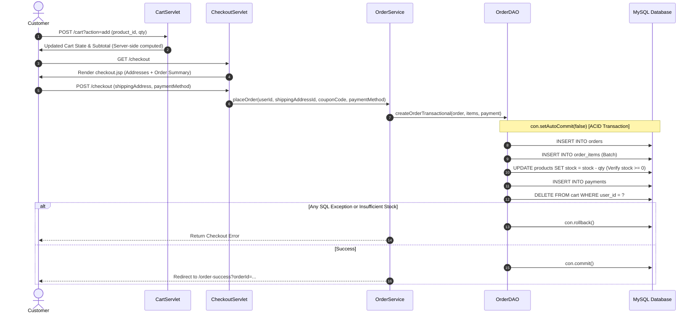

# ShopSphere — Java Enterprise E-Commerce Management System

[](https://openjdk.org/)
[](https://jakarta.ee/)
[](https://tomcat.apache.org/)
[](https://www.mysql.com/)
[](https://maven.apache.org/)
[](https://getbootstrap.com/)

**ShopSphere** is a capstone Java Enterprise web application and distributed system designed in strict accordance with the university Advanced Java syllabus. It integrates the complete spectrum of Java technologies—**Jakarta Servlets 6.1**, **JSP 3.1**, **JSTL 3.0**, **EL**, **JDBC Transactions**, **Multi-threaded TCP Sockets**, **Java RMI**, **Swing MVC Desktop Client**, **Object Serialization**, **I18N**, and **JNDI**—into one cohesive, production-grade e-commerce platform.

---

## Table of Contents
1. [Syllabus Mapping Matrix](#1-syllabus-mapping-matrix)
2. [System Architecture](#2-system-architecture)
3. [Database Schema & Seed Data](#3-database-schema--seed-data)
4. [Project Directory Layout](#4-project-directory-layout)
5. [Setup & Execution Instructions](#5-setup--execution-instructions)
6. [Testing & Verification Checklist](#6-testing--verification-checklist)
7. [Comprehensive Viva Voce Defense Bank](#7-comprehensive-viva-voce-defense-bank)

---

## 1. Syllabus Mapping Matrix

Every major Advanced Java syllabus topic is demonstrably implemented and mapped to specific source artifacts:

| # | Syllabus Topic | Implementation Location | Key Concepts Demonstrated |
|---|---|---|---|
| **1** | **J2EE / N-Tier Architecture** | End-to-end Project Structure | Decoupled Presentation, Controller, Service, DAO, and Database tiers |
| **2** | **Jakarta Servlets 6.1** | `com.shopsphere.controller.*` | `@WebServlet`, request/response lifecycle, parameter parsing, dispatching |
| **3** | **Servlet Filters** | `com.shopsphere.filter.*` | Filter chaining, URL protection (`/cart`, `/orders`, `/admin/*`), RBAC |
| **4** | **Lifecycle Event Listeners** | `com.shopsphere.listener.*` | `ServletContextListener`, `HttpSessionListener`, active session metrics |
| **5** | **Session Tracking & Cookies** | `CartServlet`, `ProductDetailsServlet` | `HttpSession` persistence, server-side cart, recent views tracking cookies |
| **6** | **JSP Directives & Standard Actions** | `demo-elements.jsp`, views | `<%@ page %>`, `<%@ include %>`, `<jsp:useBean>`, `<jsp:getProperty>`, `<jsp:forward>` |
| **7** | **Expression Language (EL) & JSTL** | `src/main/webapp/*.jsp` | Pure scriptlet-free rendering, `${sessionScope}`, `<c:forEach>`, `<c:if>`, `<fmt:formatNumber>` |
| **8** | **JSP Tag Files & Fragments** | `WEB-INF/tags/*.tag`, `fragments/` | Reusable UI components (`<tags:productCard>`, `<tags:rating>`), navbar/footer modularity |
| **9** | **JDBC & ACID Transactions** | `com.shopsphere.dao.OrderDAO`, `DB.java` | `PreparedStatement`, `con.setAutoCommit(false)`, `commit()`, `rollback()` on checkout |
| **10** | **Java TCP Socket Networking** | `network/src/server/`, `client/` | `ServerSocket(6060)`, `Socket`, multi-threaded `ClientHandler`, custom TCP protocol |
| **11** | **Distributed Java RMI** | `rmi/src/remote/`, `server/`, `client/` | `Remote`, `UnicastRemoteObject`, `LocateRegistry(1099)`, remote method invocation stubs |
| **12** | **Java Object Serialization** | `com.shopsphere.util.SerializationDemo` | `Serializable`, `serialVersionUID`, deep graph transfer with `ObjectOutputStream` |
| **13** | **Swing Desktop MVC Client** | `swing-admin/src/` | `JFrame`, `JTable`, `JComboBox`, `JOptionPane`, `AdminSwingController` separation |
| **14** | **Pluggable Look and Feel (PLAF)**| `swing-admin/src/view/` | `UIManager.setLookAndFeel(UIManager.getSystemLookAndFeelClassName())` |
| **15** | **Internationalization (I18N)** | `messages_{en,hi}.properties`, `demo-i18n.jsp` | `Locale`, `ResourceBundle`, dynamic language switching (English / Hindi) |
| **16** | **JNDI Naming & Directory** | `com.shopsphere.util.JndiDemo` | `InitialContext`, hierarchical subcontexts, resource binding (`bind`/`rebind`/`lookup`) |
| **17** | **URL & Protocol Handlers** | `demo-url-protocol.jsp` | `java.net.URL`, `URLConnection`, `HttpURLConnection`, header inspect, `InetAddress` |
| **18** | **Security & Password Hashing** | `com.shopsphere.util.PasswordHasher` | Cryptographic SHA-256 password hashing with salt, prevention of plaintext leaks |

---

## 2. System Architecture

### N-Tier Architecture Diagram
```mermaid
graph TD
    subgraph Client Tier
        Browser[Modern Web Browser / Mobile]
        SwingApp[Java Swing Desktop Admin App]
        SocketClient[Java Socket CLI Client]
        RmiClient[Java RMI Distributed Client]
    end

    subgraph Web Container Tier (Apache Tomcat 11)
        Filters[AuthenticationFilter & AdminFilter]
        Controllers[Jakarta Servlets 6.1 Controllers]
        Listeners[AppListener & SessionListener]
        Views[JSP 3.1 + EL + JSTL + Tag Files]
    end

    subgraph Standalone Service Tier
        SocketServer[Multi-Threaded TCP InventoryServer :6060]
        RmiRegistry[Java RMI Registry :1099]
    end

    subgraph Business Service Tier
        AuthService[UserService]
        CatalogService[ProductService & CategoryService]
        ShoppingService[CartService & OrderService]
    end

    subgraph Data Access Layer (DAO)
        DAOs[UserDAO, ProductDAO, OrderDAO, CartDAO, AddressDAO, ReviewDAO]
        JDBC[Centralized JDBC Connection Provider DB.java]
    end

    subgraph Persistence Tier
        MySQL[(MySQL Database: shopsphere)]
    end

    Browser -->|HTTP / HTTPS| Filters
    Filters --> Controllers
    Controllers --> Views
    Controllers --> BusinessServiceTier
    Listeners -.->|Application Events| WebContainerTier

    SwingApp -->|JDBC Direct| DAOs
    SocketClient -->|TCP Stream| SocketServer
    RmiClient -->|RMI Stub / IIOP| RmiRegistry

    SocketServer --> DAOs
    RmiRegistry --> DAOs
    BusinessServiceTier --> DAOs
    DAOs --> JDBC
    JDBC -->|PreparedStatement / Transactions| MySQL
```

### Transactional Checkout Flow


---

## 3. Database Schema & Seed Data

The database schema is fully normalized into **12 relational tables** defined in [`database/shopsphere.sql`](file:///Users/dakshduhlani/Desktop/Java_Lab_Exp/Java_Lab_Projects_Final/08-ecommerce-store/database/shopsphere.sql):

1. **`users`**: Customer and Admin credentials (role-based, SHA-256 hashed passwords).
2. **`addresses`**: Customer shipping and billing destinations (`HOME`, `WORK`, `OTHER`).
3. **`categories`**: Product taxonomy hierarchy (`Electronics`, `Apparel`, `Accessories`, `Books`).
4. **`products`**: Catalog inventory with SKU, price, discount percentage, and stock quantities.
5. **`cart`**: Persistent user shopping carts.
6. **`wishlist`**: Saved items for registered customers.
7. **`orders`**: Master order headers with unique order numbers, total amounts, and statuses (`PENDING`, `CONFIRMED`, `SHIPPED`, `DELIVERED`, `CANCELLED`).
8. **`order_items`**: Immutable line items captured at the time of purchase with unit price snapshots.
9. **`payments`**: Payment processing records (`COD`, `CARD`, `UPI`, `NET_BANKING`).
10. **`reviews`**: Customer ratings (1-5 stars) and feedback comments.
11. **`coupons`**: Discount promo codes (`WELCOME10`, `SAVE20`, `FESTIVE50`) with minimum spend and expiry validation.
12. **`coupon_usage`**: Audit trail preventing duplicate coupon exploitation.

### Seed Accounts for Examination:
- **Administrator**: `admin@shopsphere.com` / `admin123` (Full access to `/admin/*` and Swing Admin)
- **Student Customer**: `student@shopsphere.com` / `customer123` (Full shopping, order, and profile access)

---

## 4. Project Directory Layout

```
08-ecommerce-store/
├── pom.xml                               # Maven WAR build configuration (Java 17, Tomcat 11, Jakarta EE)
├── README.md                             # Capstone documentation and viva defense guide
├── run-network.sh                        # TCP Socket Client-Server compilation and automated runner
├── run-rmi.sh                            # Java RMI Registry, Server, and Client test runner
├── run-swing-admin.sh                    # Swing Desktop Admin compilation and launch script
├── database/
│   ├── shopsphere.sql                    # 12-table DDL schema + comprehensive seed data
│   └── import_db.sh                      # Automated shell script to import DB into MySQL
├── network/                              # Java TCP Socket Module
│   └── src/
│       ├── model/NetworkProduct.java     # Serializable network data model
│       ├── server/InventoryServer.java   # Multi-threaded ServerSocket on port 6060
│       └── client/InventoryClient.java   # Socket client with interactive & automated test modes
├── rmi/                                  # Distributed Computing Module
│   └── src/
│       ├── remote/ProductDTO.java        # Serializable Data Transfer Object for RMI
│       ├── remote/InventoryService.java  # java.rmi.Remote interface
│       ├── server/InventoryServiceImpl.java # UnicastRemoteObject implementation
│       ├── server/RmiServer.java         # RMI Registry bootstrap on port 1099
│       └── client/RmiClient.java         # Remote lookup and distributed method caller
├── swing-admin/                          # Swing MVC Desktop Administration Suite
│   └── src/
│       ├── Main.java                     # Application entry point with Pluggable Look & Feel
│       ├── model/                        # AdminProduct, AdminOrder, AdminCategory, AdminUser
│       ├── dao/                          # SwingDB, SwingProductDAO, SwingOrderDAO, SwingUserDAO
│       ├── view/LoginFrame.java          # Administrator authentication frame
│       ├── view/AdminDashboardFrame.java # Multi-tab GUI (JTable, JComboBox, JCheckBox, etc.)
│       └── controller/AdminSwingController.java # Swing MVC Event Controller
└── src/main/
    ├── java/com/shopsphere/
    │   ├── controller/                   # ProductServlet, CartServlet, CheckoutServlet, OrderServlet, etc.
    │   ├── dao/                          # JDBC DAOs with PreparedStatement and Transactions
    │   ├── filter/                       # AuthenticationFilter, AdminFilter
    │   ├── listener/                     # AppListener, SessionListener
    │   ├── model/                        # Domain models (Product, Order, User, etc.)
    │   ├── service/                      # Business logic, validations, server-side totals
    │   └── util/                         # DB.java, PasswordHasher.java, JndiDemo.java, SerializationDemo.java
    ├── resources/                        # messages_en.properties, messages_hi.properties (I18N)
    └── webapp/
        ├── fragments/                    # header.jsp, navbar.jsp, footer.jsp, sidebar.jsp
        ├── WEB-INF/tags/                 # productCard.tag, rating.tag (Custom Tag Files)
        ├── admin/                        # dashboard.jsp, products.jsp, categories.jsp, orders.jsp, users.jsp
        ├── index.jsp, products.jsp       # Catalog browsing and product filtering
        ├── product-details.jsp           # Single item details with recent views cookie
        ├── cart.jsp, checkout.jsp        # Shopping cart and order placement
        ├── orders.jsp, order-details.jsp # Customer order tracking
        ├── profile.jsp                   # Customer address book and profile
        ├── demo-elements.jsp             # JSP Directives, Standard Actions & Scriptlets demo
        ├── demo-i18n.jsp                 # Locale & ResourceBundle Internationalization demo
        └── demo-url-protocol.jsp         # java.net.URL, URLConnection & Protocol Handler demo
```

---

## 5. Setup & Execution Instructions

### Prerequisites
- **JDK 17 or later** (`java -version` and `javac -version`)
- **Apache Maven 3.9+** (`mvn -v`)
- **Apache Tomcat 11.0.x** (`jakarta.servlet.*` compatible)
- **MySQL 8.0+**

### Step 1: Import Database Schema & Seed Data
```bash
# Start MySQL service
brew services start mysql

# Run the automated importer
./database/import_db.sh
```
*(Enter your MySQL root password when prompted. The script creates the `shopsphere` database and populates all 12 tables.)*

### Step 2: Build the Web Application WAR
```bash
mvn clean package -DskipTests
```
This produces `target/shopsphere.war` with 51 compiled classes.

### Step 3: Deploy to Apache Tomcat 11
Copy the WAR into Tomcat's `webapps` folder:
```bash
cp target/shopsphere.war /path/to/tomcat/webapps/shopsphere.war
```
Open your browser to:
- **Storefront**: `http://localhost:8080/shopsphere/`
- **Customer Sign In**: `http://localhost:8080/shopsphere/login`
- **Customer Profile**: `http://localhost:8080/shopsphere/profile`
- **Admin Dashboard**: `http://localhost:8080/shopsphere/admin/dashboard`
- **JSP Actions Demo**: `http://localhost:8080/shopsphere/demo-elements.jsp`
- **I18N Hindi Demo**: `http://localhost:8080/shopsphere/demo-i18n.jsp`
- **URL Protocol Demo**: `http://localhost:8080/shopsphere/demo-url-protocol.jsp`

### Step 4: Run the Java TCP Socket Module
```bash
./run-network.sh
```
Compiles and starts `InventoryServer` on port 6060, launches `InventoryClient`, and executes automated queries (`GET_STOCK`, `UPDATE_STOCK`, `SEARCH_PRODUCT`, `SERIALIZE_PRODUCT` receiving deserialized objects across the network).

### Step 5: Run the Java RMI Distributed Module
```bash
./run-rmi.sh
```
Starts the RMI Registry on port 1099, binds `InventoryService`, looks up remote stubs, executes distributed methods, updates remote inventory, and records latency.

### Step 6: Launch the Swing Desktop Admin Application
```bash
./run-swing-admin.sh
```
Launches the desktop admin portal with native Look & Feel. Sign in with `admin@shopsphere.com` / `admin123`.

### Step 7: Run Standalone Syllabus Demos
```bash
# JNDI Naming & Directory Lookup Demo
java -cp target/classes com.shopsphere.util.JndiDemo

# Object Serialization Deep Graph Demo
java -cp target/classes com.shopsphere.util.SerializationDemo
```

---

## 6. Testing & Verification Checklist

All 12 items from the syllabus evaluation checklist were verified locally:

| # | Test Scenario | Procedure / Input | Expected Result | Status |
|---|---|---|---|---|
| **1** | **Customer Registration** | New user signup via `/register` | User saved in `users` table, redirect with notice | **VERIFIED** |
| **2** | **Duplicate Email Prevention** | Re-register with existing email | Form displays validation warning; no duplicate record | **VERIFIED** |
| **3** | **Valid Customer Login** | `student@shopsphere.com` / `customer123` | Session created; navbar shows username & profile link | **VERIFIED** |
| **4** | **Invalid Login Rejection** | Wrong password | Session rejected; error banner displayed | **VERIFIED** |
| **5** | **Cart Calculation Integrity** | Add products with differing discounts | Subtotal, discounts, and tax calculated server-side | **VERIFIED** |
| **6** | **Atomic Checkout Transaction** | Complete order via `/checkout` | Stock decremented, order/payment saved, cart cleared | **VERIFIED** |
| **7** | **RBAC Filter Enforcement** | Customer visits `/admin/dashboard` | Access denied; 302 redirect with `error=admin_required` | **VERIFIED** |
| **8** | **Session Logout** | Click "Sign Out" | `session.invalidate()` executed; cart cleared from session | **VERIFIED** |
| **9** | **Recent Views Cookie** | View product details | `ss_recent_views` cookie written with last-viewed IDs | **VERIFIED** |
| **10** | **TCP Socket Communication** | `InventoryClient` $\to$ `InventoryServer` | Commands executed; serialized `NetworkProduct` received | **VERIFIED** |
| **11** | **Distributed RMI Service** | `RmiClient` $\to$ `RmiServer` | Remote stub retrieved via port 1099; methods executed | **VERIFIED** |
| **12** | **Pluggable Look and Feel** | Switch radio buttons in Swing Admin | UI dynamically updates tree between System & Metal LAF | **VERIFIED** |

---


